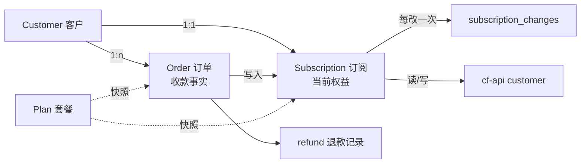
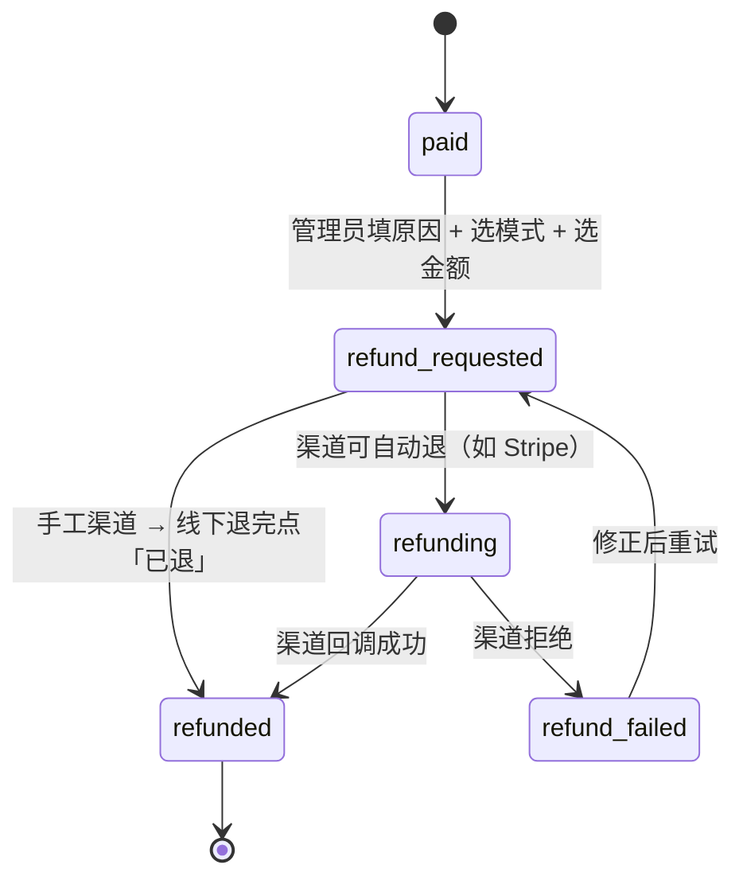

# 领域模型（客户 / 订单 / 订阅 / 退款）

Last updated: 2026-10-24

> 本文是 CRM 的**领域模型唯一出处**。它约束后续所有表结构与接口设计，
> 与 `docs/plans.md`（套餐与续订/升级规则）互补：那边讲"怎么算钱"，这边讲"东西是什么"。
> 具体表结构见 [`schema.md`](schema.md)。

## 0. 一句话

**客户是身份，订单是钱，订阅是权益，套餐是商品。四者分离，各自可独立查询，
但权益必须有来源。**

## 1. 四个概念

| 概念 | 定义 | **不是** |
|---|---|---|
| **客户 Customer** | 一个身份（邮箱 / `auth_id`）。本身不含任何权益 | 不是"一个订阅"：同一客户可以买了过期再买 |
| **订单 Order** | 一次**收款**的商业事实：谁、多少钱、什么渠道、什么时间、谁操作的 | 不是权益；订单可以退款而不影响订阅（见 §6） |
| **订阅 Subscription** | 一份**正在生效**的使用权：期限、流量、线路、重置锚点。**一个客户最多一行** | 不是钱；也不是历史（历史在 `orders` 与 `subscription_changes`） |
| **套餐 Plan** | 可售卖的商品定义（会改价、会下线） | 不改历史：订单与订阅都存**快照** |

**`plans` 是可变目录，不做版本链。** 改价/改权益直接改这一行：历史之所以安全，
是因为成交事实各自冻结（`orders.plan_snapshot` + `platform_subscriptions` 的权益列），
不是靠"套餐行不可修改"。因此也不需要「克隆新版本」这套流程 —— `plan_id` 长期稳定，
收入统计可以直接 `GROUP BY plan_id`。

### 1.1 与 cf-api 的分工

| 数据 | 真相在哪 | 说明 |
|---|---|---|
| 客户的**生效状态**（是否能连） | **cf-api** | 心跳热路径会按实际用量扣 `traffic_balance`，扣到阈值自动冻结 |
| 客户的**账期与额度规则** | **CRM** | 平台 `customers.quota` 恒为 NULL（否则平台按自然月重置，与购买日错位） |
| **钱** | **CRM** | cf-api 完全不知道订单、价格、收入 |

> 结论：cf-api 管"能不能用、还剩多少"，CRM 管"为什么有、花了多少钱、什么时候续"。

### 1.2 订阅只有一行（状态表 / 历史表）

`platform_subscriptions` **一个客户最多一行**（`UNIQUE(customer_id)`）。它只回答一个问题：
**现在还能用到什么时候、还剩多少。**

历史不放在这张表里，因为已经有专门的地方：

| 表 | 回答什么 | 能否修改 |
|---|---|---|
| `platform_subscriptions` | **现在**是什么权益（一行 = 一份） | 可改，但每次改都写一条流水 |
| `subscription_changes` | 每次变化**从什么变成什么**（before / after + 来源） | 只追加 |
| `orders` | **为什么有**：谁、多少钱、买了什么（套餐快照） | 只推进状态，金额不变 |
| `adjustments` | 人工调账（补偿、改额度） | 只追加 |

为什么必须是单行：我们定了“同一时刻只有一份主订阅”“续订 = 顺延”“升级 = 换一份”，
**根本不存在“未来排队生效的那一份”**。多行模型（每次变化插一行、旧行标 `replaced`）
唯一的好处是把历史留在订阅表里，而这个任务上面两张表已经承担了。

代价与前提：改写这一行时**必须**在 `subscription_changes` 记完整的 before / after
（到期日、套餐、`kind`、余额），否则退款模式 A 无法回滚到购买前状态。

加购包（`addon`）不占订阅行：它只往这一行的 `period_extra_gb`（额外流量池）上加 GB。

### 1.3 状态是算出来的，并且要告诉用户具体原因

`status` **不是存储字段**，由原始事实计算得出。**决定状态的事实只有两样**：

| 存什么 | 谁写 | 说明 |
|---|---|---|
| `expires_at` | 订单发放 / 退款回滚 | 空 = 永久（不限时的流量包） |
| `hold` = `none` / `frozen` / `revoked` + `hold_reason` | 管理员冻结、退款模式 A 作废 | **手工控制位** |

计算规则（**从上到下取第一个命中**）。对外只给三样东西：**能否用**（`status`）、
**为什么不能用**（`reason`）、**给用户看的整句**（`status_text`）：

| 顺序 | 条件 | `status` | `reason` | `status_text` | 能连吗 |
|---|---|---|---|---|---|
| 1 | `hold = 'revoked'` | `inactive` | `frozen` | 订阅已被暂停，请联系客服 | ❌ |
| 2 | `hold = 'frozen'` | `inactive` | `frozen` | `hold_reason` 整句 | ❌ |
| 3 | `expires_at` 非空且 ≤ 现在 | `inactive` | `expired` | 已于 X 月 X 日到期 | ❌ |
| 4 | 本周期 / 本包可用流量 ≤ 0 | `inactive` | `exhausted` | 流量已用完（周期套餐附重置日） | ❌ |
| 5 | 其余 | `active` | `null` | 生效中 | ✅ |

三条规则说明：

- **把“原因”从 `status` 里拿出来的原因**：每加一种停用原因就多一个状态值，
  App 的放行判断就得跟着改一次。现在 App 只判断一条 `status === "active"`，
  新增原因只需改 CRM（App 照旧展示 `status_text`）。
- `expired` 对周期套餐是**本周期**用完（重置后自动恢复），对流量包是**整包**用完。
  不限量套餐（`traffic_remaining_gb = NULL`）永远不会 `exhausted`；`traffic_remaining_gb = null`
  在其它情况下表示“未同步”（缓存还没回源），**不是 0**。
- **没有 cron 去写 `expired`**：过期是读的时候算出来的，不会出现“到期了但任务没跑”的状态错误。

“能不能连”的**最终判定仍在 cf-api**（心跳读自己的 `traffic_balance`）；CRM 算出的
`status` 用于**展示与报价**。唯一例外：`frozen` / `revoked` 是**意图**，必须同步到
cf-api 禁用该客户，否则用户照样能连。

## 2. 关系



**用户的购买动作只有四种**，对订阅的影响各不相同：

| 动作 | 什么时候 | 应付 | 对那一行订阅做了什么 |
|---|---|---|---|
| **新购/直购** `buy` | 没有可用订阅，**或买的是加量包** | 目录价 | 新购写新快照（`order_id` = 这笔单）；加量包不动订阅，只 `period_extra_gb +=` |
| **续订** `renewal` | 有订阅、买的**同一个套餐** | 目录价（全款） | 到期日 = `max(现在, 原到期日) + 期限` |
| **升级** `upgrade` | 有订阅、目标**标价更高**（含换 `kind`） | 新价 − 残值，**必须 > 0** | 换成新快照（到期日 = 现在 + 新期限） |

推论：

- **升级只认标价**：`目标 price_minor > 当前套餐 price_minor`。标价相同/更低一律拒，
  哪怕残值抵扣后应付 > 0（否则“花更少的钱换一个更贵的套餐”会成为漏洞）。
- **残值只按实付价算**：`price_minor` 用来比贵，`paid_minor` 用来折钱，两个数在促销时会分叉。
- **加量包不折钱**：它是纯 GB 数量，升级时**原样搬到新订阅**（目标是 period 就留在池子里，
  目标是 traffic 就并进流量包），不参与残值计算；它也**不覆盖 `paid_minor`**（那是主订阅成交价）。
- 每一条权益变化都能追溯到一行 `orders` 或 `adjustments`。

## 3. 六条不变量

| # | 不变量 | 违反后果 |
|---|---|---|
| **I1** | 权益必须有来源：`order`（含赠单）或 `adjustment`，二选一；**不允许出现"凭空"的订阅** | 客服查不到某客户为何有权益；对账缺一笔 |
| **I2** | 订单与订阅都存**套餐快照**（价格 / 额度 / 有效期 / 线路），改套餐不影响历史 | 改价后历史订单金额跟着变，账全错 |
| **I3** | `expire_date` / `licence_limit` / `line_ids` 以 **CRM 账本为准**，绝对值投影到 cf-api | — |
| **I4** | `traffic_balance` 的真相在 **cf-api**（心跳扣减）。CRM 只在「重置点」与「加量 / 赠送 / 改额度」时以**差值**方式触碰它，**永不**用本地推算的绝对值覆盖 | 覆盖会把客户已用量还回来 |
| **I5** | 收入 = Σ(已支付) − Σ(已退款)；赠单不计收入，只计「发放」 | 统计虚高 |
| **I6** | 退款只有两种模式（§6）；**已被升级掉残值的订阅禁止退款** | 同一份权益被退两次 |
| **I7** | 一个客户**最多一行**订阅（`UNIQUE(customer_id)`）；历史只在 `orders` / `subscription_changes` | “当前是哪一份”变模糊；续订、退款都会算错 |

## 4. 参数归属与三个操作

### 4.1 归属表

| 参数 | 真相在 | CRM 何时写 | 写入语义 |
|---|---|---|---|
| `traffic_balance` | **cf-api**（心跳扣减） | ① 重置点（cron）② 加量 / 赠送 / 改额度 / 退款回滚 | **读 → 加差值 → 写回** |
| `period_quota_gb`（月额度） | CRM | 改额度 | 只在本地，决定下次重置给多少 |
| `period_extra_gb`（额外流量池） | CRM | 加量包、赠送、邀请奖励 | `period_extra_gb += Δ`，**不随月度重置清零** |
| `traffic_remaining_gb`（平台剩余缓存） | **cf-api** | 展示/报价前懒同步（TTL 15min）、每月结算 | 只缓存，**写平台前必须强制回源** |
| `expire_date` | CRM | 新购 / 续订 / 升级 / 退款回滚 | 绝对值投影 |
| `licence_limit` / `line_ids` | CRM | 变更 / 绑定 | 绝对值投影 |

### 4.2 周期重置（cron，每小时跑，只在锚点生效）

```
剩余   = readPlatformBalance(客户)                          // cf-api 实际还剩多少
新余额 = period_quota_gb + min(period_extra_gb, 剩余)       // 池子抵扣不超过真实剩余
writePlatformBalance(新余额)
// 不动 period_quota_gb、不动 period_extra_gb（但会把池子写成 min(B, 剩余)，并刷新 remaining 缓存）
```

### 4.3 管理员改月额度（100 → 200）

```
Δ = 200 - 100 = +100
quota_gb = 200                                // 影响下次重置
writePlatformBalance(readPlatformBalance() + Δ)
```

### 4.4 赠送流量（0 元礼品包，50 GB）

```
writePlatformBalance(readPlatformBalance() + 50)
balance_gb += 50                              // 记入结转，跨期不丢
```

> ⚠️ §4.3 / §4.4 都是「读当前 + 加差值」：本地**不知道客户此刻用了多少**，
> 任何"本地算好一个绝对值直接写"的做法都会把已用量还回去。

**已知残留**：读与写之间毫秒级窗口可能撞上心跳扣减，吞掉一次扣减（量级极小）。
下次重置会以 cf-api 实际值自动纠偏；`adjustments` 记录 before/Δ/after 便于事后核对。
彻底解决需 cf-api 提供**原子增量接口**（`POST /customers/:id/traffic {delta}`），
当前只有 `PATCH` 绝对值 —— 已记为 cf-api 侧待办，不阻塞 CRM。

## 5. 礼品包（赠送）

**"礼物"不是新实体，而是"价格为 0 的隐藏套餐 + `source = gift` 的订单"。**

| 项 | 值 |
|---|---|
| 类型 | 普通 `addon`（送流量）或 `period`（送时长） |
| 价格 | `price_minor = 0` |
| 可见性 | `visibility = hidden` —— App 套餐列表**不展示**，否则人人白领 |
| 下单 | 管理员在客户页点「赠送」→ 选礼品包 → 生成 `orders.source = gift`，金额 0 |
| 效果 | 加量包：给现有订阅加余额；周期包：产生或延长订阅 |
| 统计 | 不计收入，计入「发放额度」`granted_gb` |
| 审计 | 必填赠送原因；记录操作人 |

UI 上不出现"订单"这个词：管理员看到的是「赠送时长 / 赠送流量」。

### 5.1 免费试用（与礼包是两件事）

礼包是**营销动作**（对已有订阅加天数/流量）；免费试用是**一份真的套餐**，
所以它回答得了"这 7 天给多少流量、几条线路、几个设备"—— 礼包回答不了。

| 项 | 规则 |
|---|---|
| 数量 | **全库最多一个**（`plans.trial = 1`，部分唯一索引 `uq_plans_trial`） |
| 形态 | 必须是 `period`；`price_minor` 强制 0；`visibility` 强制 `hidden` |
| 能否买 | **不能**。`POST /orders` 命中试用套餐一律 403（否则就是绕开注册的 0 元购买入口） |
| 何时开通 | 新客户**注册成功**时自动开通（`/auth/verify` 建号后） |
| 走网关吗 | 不走。但**要走同一条发放链路**：0 元 `source='signup'` 订单 → 建订阅 → 建 cf-api 客户（失败停在 `provisioning`，由 `retryProvisioning` 重试） |
| 幂等 | 一个客户只有一行订阅；`source='signup'` 的订单只可能有一张 ⇒ 重复调用不会双开 |
| App 侧 | 只调 `GET /trial` 拿展示材料（含 CRM 组织好的一句 `text`），不判断业务 |
| 文案 | 由 CRM 组织：`免费试用 · 还剩 3 天` / `试用已于 10-06 结束 · 升级后可继续使用` |
| 转正 | 试用订阅 `paid_minor = 0` ⇒ 残值 0 ⇒ 升级按**全价**；试用套餐是 hidden，所以不会出现"续订试用" |

⚠️ **运维硬约束**：试用套餐的 `licence_limit` 必须与正式套餐一致 ——
设备数变了，cf-api 会删旧建新并**换激活码**（`crm-api.md` §3.4），用户要重新登录客户端。

## 6. 退款

退款是**针对订单**的行为，金额可以部分。

| 模式 | 名称 | 订单 | 订阅 | cf-api | 金额 |
|---|---|---|---|---|---|
| A | `refund_and_void` | `voided_at` 置位，作废 | `hold = 'revoked'`（算出来的状态即 `revoked`） | 回滚到**购买前快照** | 可部分（如退 60 / 100） |
| B | `refund_only` | **继续有效**（`refunded_minor` 累加） | **继续有效** | 不动 | 可部分或全额 |



字段（订单上）：

```
refunded_minor  INTEGER NOT NULL DEFAULT 0   -- 累计已退
voided_at       TEXT                          -- 作废时间（仅模式 A）
refund_mode     TEXT                          -- refund_and_void | refund_only
refund_reason   TEXT
```

状态判定：

- `refunded_minor < amount_minor` → 订单状态仍为 `paid`（部分退款，订单有效）
- `refunded_minor = amount_minor` → `status = refunded`
- 模式 A 不论退多少，额外置 `voided_at` + 订阅 `revoked`

护栏：

1. 已被升级掉残值的订阅**禁止退款**（先处理升级单）；
2. 模式 A 回滚的是**购买前快照**（不是置零）——客户原本可能还有余额 / 时长；
3. 已消耗的流量不退（用了就是用了）。

## 7. 订单状态与详情页

### 7.1 状态机

```
pending ──支付成功──▶ paid ──下发成功──▶ active
   │                    │                  │
   │                    ├──退款──▶ refunded（可能同时 voided）
   └──超时/取消──▶ closed
```

### 7.2 订单详情页必须包含

| 区块 | 内容 |
|---|---|
| 头部 | 订单号、状态、来源（自助 / 赠送 / 补单）、渠道、金额、币种、外部流水号、操作人 |
| 客户 | 邮箱、cf-api 客户 ID、当前订阅摘要（状态 / 余额 / 到期 / 设备数） |
| 商品 | 套餐快照：名称、`kind`、价格、额度、有效期、线路 |
| **权益变更** | `before → after`：`traffic_balance`、`expire_date`、`licence_limit`、`quota`；下发结果（成功 / 失败 / 重试次数 / 时间） |
| 结算 | 残值抵扣明细（升级时）、应付、实付、已退 |
| 时间线 | created → paid → provisioning → active →（refunded / voided） |
| 操作 | 重试下发、退款、作废、调整参数（走 `adjustments`）、备注 |

## 8. 收入统计口径

| 指标 | 公式 | 备注 |
|---|---|---|
| GMV | `Σ amount_minor`（按支付时间） | 不含未支付 |
| 退款 | `Σ refunded_minor` | 按退款时间 |
| **净收入** | `GMV − 退款 − 渠道手续费` | 手续费先按渠道静态费率 |
| 发放额度 | `Σ granted_gb` | 含赠单；**不计收入** |
| 维度 | 日 / 月 × 渠道 × 套餐 ×（新购 / 续订 / 升级 / 加购 / 赠送） | |

结算（重置）**不影响收入**。

## 9. 支付

正文在 [`payments.md`](payments.md)（词表 / 状态机 / 网关 / 映射），这里只留三条边界：

| 边界 | 规定 |
|---|---|
| 用户看到什么 | **只有支付方式**（支付宝/微信/PayPal/Stripe）；服务商与网关对用户不存在 |
| 订单粒度 | `orders` 一行 = **一次支付尝试**（回调只带单号，单号必须永远唯一对应一行） |
| 谁判定已付 | **`queryCharge`**。回调只是触发器，验签后仍要查单 |

原则：**CRM 只做配置 + 回调验签 + 记账，不存任何卡信息。**
`manual`（对公转账）与 `gift`（赠送）复用同一条「确认到账」流程。

## 10. 落地顺序

| 步骤 | 内容 | 依赖 |
|---|---|---|
| **D1** | `orders` 表 + 状态机 + 创建 / 支付 / 确认（先支持 `manual` 与 `gift`） | 本文 |
| D2 | 订单详情页（含权益变更与重试） | D1 |
| D3 | `adjustments` + 客户详情页（含 cf-api 实际值对比） | D1 |
| D4 | `payment_gateways` + 驱动 + 回调验签 + cron 兜底查单 | D1 |
| D5 | 收入统计页 | D1 |
| D6 | 客户 / 订单列表页（桌面表格 / 手机卡片） | D1 |

## 11. 未决

1. cf-api 是否需要提供**原子增量接口**（`traffic_balance` 的 `+=`）——记为 cf-api 侧待办。
2. 部分退款的**上限**是否允许超过"按剩余价值"计算出的金额（当前建议：不限制，由管理员判断）。
3. 试用套餐（`is_trial`）是否参与残值抵扣（当前建议：不参与）。
